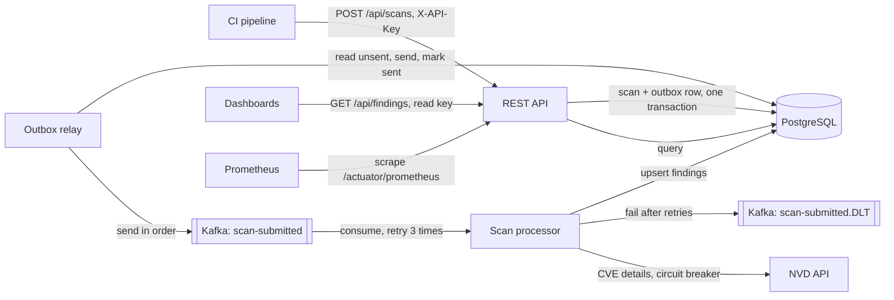

# VulnTrack

[](https://github.com/rayapatibharathi4-afk/vulntrack/actions/workflows/ci.yml)

> Turns CI vulnerability scan reports into tracked, deadline-driven findings.

VulnTrack is a backend service that ingests dependency vulnerability scan reports from CI pipelines, enriches each CVE with data from the NVD API, tracks every finding against a severity-based SLA, and exposes REST APIs for listing findings and checking scan status. Scans are processed asynchronously through Kafka, so a slow NVD API or a large report never blocks the CI pipeline.

**Status:** Milestones 0–6 are complete, apart from the live checks noted in the build log. See [Roadmap](#roadmap).

**Not built yet:** assigning findings and closing them by hand (fixes are detected by scans).

---

## Why

A scanner such as OWASP Dependency-Check runs on every build and reports vulnerable libraries (for example `log4j-core 2.14.1` → `CVE-2021-44228`, Log4Shell). The report then sits in a build log: nobody owns the fix, nobody knows if it was fixed, and nobody can answer *"which critical problems have we ignored for more than 7 days?"*

VulnTrack answers that:

- every vulnerable dependency becomes a **finding** with a deadline
- the same problem reported again **never creates a duplicate**
- when a later scan no longer reports it, the finding is **marked FIXED automatically**
- anyone can ask for everything **overdue**

| Severity | SLA (from first seen) |
|---|---|
| CRITICAL | 7 days |
| HIGH | 30 days |
| MEDIUM | 90 days |
| LOW | 180 days |

## Architecture



One Spring Boot deployable with two logical parts (REST APIs + Kafka consumer). Kafka already decouples the slow work, so splitting into microservices would add cost without benefit at this scale.

## Tech stack

| Area | Choice |
|---|---|
| Language | Java 21 |
| Framework | Spring Boot 4.1 (Web MVC, Data JPA, Validation, Actuator) |
| Database | PostgreSQL 16, Flyway migrations |
| Messaging | Kafka 4.1 (KRaft), Spring for Apache Kafka, dead-letter topic |
| Resilience / cache | Resilience4j (retry, circuit breaker), Caffeine |
| Security | Spring Security, API keys with two roles (`X-API-Key`: INGEST, VIEWER) |
| Observability | Actuator, Micrometer, Prometheus endpoint, correlation IDs in logs and Kafka headers |
| Tests | JUnit 5, AssertJ, Mockito, MockMvc; Testcontainers (PostgreSQL 16, Kafka 4.1) |
| Build and delivery | Maven Wrapper, multi-stage Dockerfile (non-root), Docker Compose, GitHub Actions, OWASP Dependency-Check |

## Getting started

**Prerequisites:** JDK 21, Docker Desktop, Git. Maven is not required (the project uses the Maven Wrapper).

```bash
# 1. Start PostgreSQL and Kafka (KRaft, no ZooKeeper)
docker compose up -d
docker compose ps            # wait for (healthy)

# 2. Run the app (Flyway creates the schema on startup)
#    Every API call needs a key. Without VULNTRACK_API_KEY the app refuses all writes.
export VULNTRACK_API_KEY=choose-a-long-random-value     # PowerShell: $env:VULNTRACK_API_KEY = "..."
./mvnw spring-boot:run       # Windows: .\mvnw spring-boot:run

# 3. Check it is up
curl http://localhost:8080/actuator/health
```

**Run everything in containers** (no local JDK needed):

```bash
export VULNTRACK_API_KEY=choose-a-long-random-value   # PowerShell: $env:VULNTRACK_API_KEY = "..."
docker compose up -d --build                          # PostgreSQL, Kafka and the app on :8080
curl http://localhost:8080/actuator/health
```

The app image is built in two stages (Maven build, then a JRE image) and runs as a non-root user.

**Run the tests** (Docker must be running: the tests start their own PostgreSQL and Kafka containers, so the local compose stack is not needed):

```bash
./mvnw clean test
```

**Optional sample data** — create the two applications below, then load the seed script:

```bash
curl -X POST http://localhost:8080/api/applications -H "Content-Type: application/json" \
     -H "X-API-Key: $VULNTRACK_API_KEY" \
     -d '{"name":"payments-service","ownerTeam":"payments"}'
curl -X POST http://localhost:8080/api/applications -H "Content-Type: application/json" \
     -H "X-API-Key: $VULNTRACK_API_KEY" \
     -d '{"name":"auth-service","ownerTeam":"identity"}'

docker exec -i vulntrack-postgres psql -U vulntrack -d vulntrack < scripts/dev-seed.sql
```

## API

| Method | Endpoint | Description |
|---|---|---|
| `POST` | `/api/applications` | Register an application. `201 Created` + `Location` header. Ingest key |
| `GET` | `/api/applications` | List applications (paged, sorted by name). Any key |
| `GET` | `/api/findings` | List findings with optional filters (paged, most urgent first). Any key |
| `POST` | `/api/scans?application={name}` | Submit an OWASP Dependency-Check JSON report. `202 Accepted` + `Location` header, status `RECEIVED`. Processing is asynchronous. Ingest key |
| `GET` | `/api/scans/{id}` | Scan status (`RECEIVED`, `PROCESSING`, `COMPLETED`, `FAILED`) and timestamps. Any key |
| `POST` | `/api/findings/{id}/accept-risk` | Accept the risk of an open finding until a date. Body: `reason`, `acceptedBy`, `expiresAt`. `200` with the finding. `409` if the finding is not open. Risk key |
| `GET` | `/actuator/health` | Health, including the database. Open |
| `GET` | `/actuator/prometheus` | Metrics for Prometheus. Read or ingest key (the risk key gets `403`) |

**Examples** (PowerShell and bash use the same `curl` syntax; the key is in `VULNTRACK_API_KEY`):

```bash
# Submit a scan: 202 Accepted, status RECEIVED
curl -i -X POST "http://localhost:8080/api/scans?application=payments-service" \
     -H "Content-Type: application/json" -H "X-API-Key: $VULNTRACK_API_KEY" \
     --data-binary @dependency-check-report.json

# Check it later: COMPLETED (or FAILED)
curl http://localhost:8080/api/scans/42 -H "X-API-Key: $VULNTRACK_API_KEY"

# Every overdue critical finding, most urgent first
curl "http://localhost:8080/api/findings?severity=CRITICAL&overdue=true" -H "X-API-Key: $VULNTRACK_API_KEY"
```

A correlation ID travels with each request. Send `X-Correlation-Id: <id>` to choose it; the response echoes it and every log line for that request shows it.

**Authentication.** Every API call sends an API key in the `X-API-Key` header:

| Key (environment variable) | Can do |
|---|---|
| `VULNTRACK_API_KEY` | read and write (CI pipelines) |
| `VULNTRACK_READ_API_KEY` | read only (dashboards, Prometheus scraping) |
| `VULNTRACK_RISK_API_KEY` | accept risks only (a security owner); cannot create scans or read |

A missing or wrong key returns `401`, and a valid key without permission returns `403`, both as Problem Details. `/actuator/health` and `/actuator/info` are open so that probes keep working. An unset key matches nothing.

**Async processing.** A submitted scan is stored as `RECEIVED`, in the same transaction as an outbox row that describes the Kafka message. A relay sends the outbox rows to the `scan-submitted` topic, in order, and marks each one sent once the broker acknowledges it. A consumer processes the scan and sets `COMPLETED`. Failed messages are retried three times with exponential backoff (1s, 2s, 4s). A report that cannot be parsed is not retried. When retries run out, the scan is marked `FAILED` and the message moves to `scan-submitted.DLT`.

Delivery is at least once, so the consumer ignores scans that are already `COMPLETED` or `FAILED`. A duplicate message does no work.

**Findings filters** (all optional, combinable):

```
GET /api/findings?status=OPEN&severity=CRITICAL&applicationId=1&overdue=true&page=0&size=20&sort=slaDueAt,asc
```

**Errors** use [RFC 9457 Problem Details](https://www.rfc-editor.org/rfc/rfc9457) (`application/problem+json`):

```json
{
  "title": "Conflict",
  "status": 409,
  "detail": "Application 'payments-service' already exists",
  "instance": "/api/applications"
}
```

| Situation | Status |
|---|---|
| Validation failure (with per-field `errors`) | 400 |
| Malformed JSON, invalid enum value, or a report that is not valid Dependency-Check JSON | 400 |
| No API key, or an unknown key | 401 |
| Valid key without the needed role | 403 |
| Unknown URL (with a valid key; without one, the response is 401) | 404 |
| Application or scan does not exist | 404 |
| Duplicate (application check or database constraint) | 409 |
| Unexpected error (details logged, never returned) | 500 |

## Data model

| Table | Purpose | Key constraint |
|---|---|---|
| `application` | Apps that send scans | `name` unique |
| `scan` | Raw report as received (JSONB) | status check |
| `dependency` | A library version used by an app | unique (application, ecosystem, name, version) |
| `cve` | A known vulnerability, shared across apps | natural key = CVE ID |
| `finding` | The ticket: this dependency has this CVE | **unique (dependency_id, cve_id)** — makes processing idempotent |

Indexes: `finding(status, sla_due_at)` for the overdue query, `finding(cve_id)` for "which apps are affected by this CVE?".

## Project structure

```
src/main/java/com/bharathi/vulntrack
├── config/       Clock bean, security (API key filter and rules)
├── ingest/       Report parser, scan submission, Kafka publisher, consumer, retry and dead-letter handling
├── nvd/          NVD client with retry and circuit breaker, scheduled CVE enrichment
├── domain/       JPA entities and enums
├── repository/   Spring Data repositories, Specifications for optional filters
├── service/      Business logic (SLA calculator, application + finding services)
└── web/          Controllers, global error handler, DTOs (records)

src/main/resources/db/migration   Flyway SQL migrations
src/test/                         Unit, MockMvc and Testcontainers tests (no internet access)
scripts/                          Local development helpers (seed data)
docs/BUILD_LOG.md                 Step-by-step log: what changed, errors and their causes
docs/INTERVIEW_NOTES.md           Talking points per milestone
Dockerfile, docker-compose.yml    Container image and the full local stack
.github/workflows/ci.yml          Build and test on every change; dependency scan on main and weekly
```

## Design decisions

1. **Flyway owns the schema, Hibernate only validates it** (`ddl-auto=validate`). Schema changes are versioned, reviewable SQL; mismatches fail at startup.
2. **Idempotency through database constraints.** At-least-once delivery means duplicates will happen; `UNIQUE (dependency_id, cve_id)` plus upserts make reprocessing safe, even under race conditions.
3. **DTOs, never entities, over HTTP.** The API contract is independent of the schema and clients can only send the fields they are allowed to.
4. **No N+1 queries.** Relationships are `LAZY`; the findings query fetches what it needs in one statement with `@EntityGraph`, and paging happens in the database.
5. **Testable time.** "Now" comes from an injected `Clock`, so overdue logic is tested with fixed dates.
6. **SQL over NoSQL.** Relational data, uniqueness rules and reporting queries with joins; JSONB keeps the raw report without a second database.
7. **Spring Boot 4.** Boot 3.x reached end of open-source support in June 2026; a vulnerability tracker should not run on an unpatched framework.
8. **Scans are accepted fast and processed later, with no lost messages.** `POST` stores the report and an outbox row in one transaction, and returns `202` in milliseconds. A relay sends the message afterwards. If the process crashes after the commit, the row is still there and is sent on restart.
9. **Failures are classified.** Bad input (a non-numeric message, an unparseable report) is never retried. Transient errors are retried three times with backoff, then the message goes to a dead-letter topic and the scan is marked `FAILED`, so nothing blocks the partition.
10. **Two Kafka listeners.** Clients on the host use `localhost:9092`; containers on the compose network use `kafka:29092`. A broker advertises one address per listener, so both are needed.
11. **API keys are hashed before comparison and fail closed.** Keys come from environment variables only. An unset key matches nothing. Two keys with separate roles: CI writes, dashboards only read.
12. **Least privilege in the container.** The runtime image has a JRE, the jar and an unprivileged user, and no build tools or secrets.

## Trade-offs and known gaps

- **Outbox relay: one bad message delays the ones behind it.** The relay sends in order and stops at the first failure, so a message the broker keeps rejecting holds back everything after it until it succeeds. That is the price of keeping order per application. The relay also holds row locks while it waits for the broker.
- **Duplicates after a crash.** If the relay sends a message and crashes before marking it sent, the message is sent again. The consumer skips scans it has already finished, so this is harmless, but it does mean duplicate messages on the topic.
- **At-least-once delivery.** Duplicates are possible. They are handled by the status check (a finished scan is skipped) and by the unique constraint on findings. This is simpler than exactly-once, which Kafka only supports with transactions end to end.
- **Static API keys.** Keys are set through environment variables. There is no rotation, no per-application key, and no audit of who used which key. Acceptable for a small team; a real deployment would move keys to a secret store and add per-client identity.
- **Metrics are only as protected as the keys.** `/actuator/prometheus` needs any valid key. Prometheus should scrape from a private network.
- **An expired risk acceptance reopens within an hour, not at the exact expiry time.** The job runs hourly; a finding can show as accepted for up to an hour past its date. Finer timing would need a per-finding timer or a shorter schedule.
- **`acceptedBy` is not verified.** The key says the caller holds the risk role, not who the person is. Per-person identity needs real user accounts.
- **Dead-letter messages are not replayed automatically.** An engineer inspects `scan-submitted.DLT`, fixes the cause, and re-submits. No replay tool yet.
- **Dependency scan is slow.** The OWASP NVD database is large. It runs on `main` and weekly, not on every pull request, so a vulnerable change can merge before the scan catches it.
- **Single instance.** Scheduled CVE enrichment and the consumer assume one or a few instances. Running many would need coordination for the scheduler; partitions already spread the consumers.

## Roadmap

- [x] **M0 – Setup:** Spring Boot + PostgreSQL in Docker, health check
- [x] **M1 – Data model + CRUD:** Flyway schema, entities, Applications and Findings APIs, error handling, tests
- [x] **M2 – Scan ingestion:** `POST /api/scans` for OWASP Dependency-Check reports, package-level upserts, auto-FIXED
- [x] **M3 – NVD enrichment:** NVD API client with timeout, retry, circuit breaker, fallback and cache
- [x] **M4 – Async processing:** Kafka, `202 Accepted`, scan status endpoint, retries, dead-letter topic, tests
- [x] **Transactional outbox (extension of M4):** scan and message written in one transaction, relay sends in order, crash-safe
- [x] **M5 – Security + observability**
  - [x] API key on write endpoints (`X-API-Key`, fail closed, 401 as Problem Details)
  - [x] Read access and roles: a read-only key, and writes need the ingest key (`403` for a valid key without permission)
  - [x] Role for risk acceptance: `POST /api/findings/{id}/accept-risk` with its own key; an expired acceptance reopens the finding on a schedule (hourly) and at the next scan
  - [x] Actuator and Micrometer metrics at `/actuator/prometheus`: Kafka consumer lag, NVD circuit breaker state, scans processed
  - [x] Correlation ID from request to log lines and Kafka message (`X-Correlation-Id`)
  - [x] Testcontainers (PostgreSQL 16 and Kafka 4.1) for all integration tests; CI no longer needs service containers
- [x] **M6 – Ship it:** GitHub Actions build and tests, multi-stage Dockerfile, OWASP Dependency-Check in CI (fails on CVSS 7+), final README and interview notes

## Author

Bharathi Rayapati