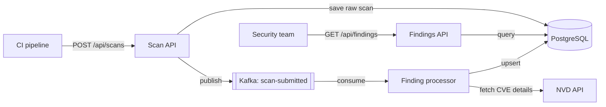

# VulnTrack

> Turns CI vulnerability scan reports into tracked, deadline-driven findings.

VulnTrack is a backend service that ingests dependency vulnerability scan reports from CI pipelines, enriches each CVE with data from the NVD API, tracks every finding against a severity-based SLA, and exposes REST APIs for listing, assigning and closing findings. Scans are processed asynchronously through Kafka, so a slow NVD API or a large report never blocks the CI pipeline.

**Status:** work in progress. Milestones 0–1 are done (data model, Applications API, Findings API, error handling, tests). Scan ingestion, NVD enrichment, Kafka, security and CI are next. See [Roadmap](#roadmap).

---

## Why

A scanner such as OWASP Dependency-Check runs on every build and reports vulnerable libraries (for example `log4j-core 2.14.1` → `CVE-2021-44228`, Log4Shell). The report then sits in a build log: nobody owns the fix, nobody knows if it was fixed, and nobody can answer *"which critical problems have we ignored for more than 7 days?"*

VulnTrack answers that:

- every vulnerable dependency becomes a **finding** with a deadline
- the same problem reported again **never creates a duplicate**
- when a later scan no longer reports it, the finding is **marked FIXED automatically**
- anyone can ask for everything **overdue**

| Severity | SLA (from first seen) |
|---|---|
| CRITICAL | 7 days |
| HIGH | 30 days |
| MEDIUM | 90 days |
| LOW | 180 days |

## Architecture



One Spring Boot deployable with two logical parts (REST APIs + Kafka consumer). Kafka already decouples the slow work, so splitting into microservices would add cost without benefit at this scale.

## Tech stack

| Area | Choice |
|---|---|
| Language | Java 21 |
| Framework | Spring Boot 4.1 (Web MVC, Data JPA, Validation, Actuator) |
| Database | PostgreSQL 16, Flyway migrations |
| Messaging | Kafka (KRaft) — *planned* |
| Resilience / cache | Resilience4j, Caffeine — *planned* |
| Security | Spring Security, JWT (ADMIN / VIEWER) — *planned* |
| Tests | JUnit 5, AssertJ, Mockito, MockMvc; Testcontainers — *planned* |
| Build | Maven Wrapper, Docker Compose |

## Getting started

**Prerequisites:** JDK 21, Docker Desktop, Git. Maven is not required (the project uses the Maven Wrapper).

```bash
# 1. Start PostgreSQL
docker compose up -d
docker compose ps            # wait for (healthy)

# 2. Run the app (Flyway creates the schema on startup)
./mvnw spring-boot:run       # Windows: .\mvnw spring-boot:run

# 3. Check it is up
curl http://localhost:8080/actuator/health
```

**Run the tests** (PostgreSQL must be running for the full-context test):

```bash
./mvnw clean test
```

**Optional sample data** — create the two applications below, then load the seed script:

```bash
curl -X POST http://localhost:8080/api/applications -H "Content-Type: application/json" \
     -d '{"name":"payments-service","ownerTeam":"payments"}'
curl -X POST http://localhost:8080/api/applications -H "Content-Type: application/json" \
     -d '{"name":"auth-service","ownerTeam":"identity"}'

docker exec -i vulntrack-postgres psql -U vulntrack -d vulntrack < scripts/dev-seed.sql
```

## API

| Method | Endpoint | Description |
|---|---|---|
| `POST` | `/api/applications` | Register an application. `201 Created` + `Location` header |
| `GET` | `/api/applications` | List applications (paged, sorted by name) |
| `GET` | `/api/findings` | List findings with optional filters (paged, most urgent first) |
| `GET` | `/actuator/health` | Health, including database, liveness and readiness |

**Findings filters** (all optional, combinable):

```
GET /api/findings?status=OPEN&severity=CRITICAL&applicationId=1&overdue=true&page=0&size=20&sort=slaDueAt,asc
```

**Errors** use [RFC 9457 Problem Details](https://www.rfc-editor.org/rfc/rfc9457) (`application/problem+json`):

```json
{
  "title": "Conflict",
  "status": 409,
  "detail": "Application 'payments-service' already exists",
  "instance": "/api/applications"
}
```

| Situation | Status |
|---|---|
| Validation failure (with per-field `errors`) | 400 |
| Malformed JSON or invalid enum value | 400 |
| Unknown URL | 404 |
| Duplicate (application check or database constraint) | 409 |
| Unexpected error (details logged, never returned) | 500 |

## Data model

| Table | Purpose | Key constraint |
|---|---|---|
| `application` | Apps that send scans | `name` unique |
| `scan` | Raw report as received (JSONB) | status check |
| `dependency` | A library version used by an app | unique (application, ecosystem, name, version) |
| `cve` | A known vulnerability, shared across apps | natural key = CVE ID |
| `finding` | The ticket: this dependency has this CVE | **unique (dependency_id, cve_id)** — makes processing idempotent |

Indexes: `finding(status, sla_due_at)` for the overdue query, `finding(cve_id)` for "which apps are affected by this CVE?".

## Project structure

```
src/main/java/com/bharathi/vulntrack
├── config/       Clock bean
├── domain/       JPA entities and enums
├── repository/   Spring Data repositories, Specifications for optional filters
├── service/      Business logic (SLA calculator, application + finding services)
└── web/          Controllers, global error handler, DTOs (records)

src/main/resources/db/migration   Flyway SQL migrations
scripts/                          Local development helpers (seed data)
```

## Design decisions

1. **Flyway owns the schema, Hibernate only validates it** (`ddl-auto=validate`). Schema changes are versioned, reviewable SQL; mismatches fail at startup.
2. **Idempotency through database constraints.** At-least-once delivery means duplicates will happen; `UNIQUE (dependency_id, cve_id)` plus upserts make reprocessing safe, even under race conditions.
3. **DTOs, never entities, over HTTP.** The API contract is independent of the schema and clients can only send the fields they are allowed to.
4. **No N+1 queries.** Relationships are `LAZY`; the findings query fetches what it needs in one statement with `@EntityGraph`, and paging happens in the database.
5. **Testable time.** "Now" comes from an injected `Clock`, so overdue logic is tested with fixed dates.
6. **SQL over NoSQL.** Relational data, uniqueness rules and reporting queries with joins; JSONB keeps the raw report without a second database.
7. **Spring Boot 4.** Boot 3.x reached end of open-source support in June 2026; a vulnerability tracker should not run on an unpatched framework.

## Roadmap

- [x] **M0 – Setup:** Spring Boot + PostgreSQL in Docker, health check
- [x] **M1 – Data model + CRUD:** Flyway schema, entities, Applications and Findings APIs, error handling, tests
- [ ] **M2 – Scan ingestion:** `POST /api/scans` for OWASP Dependency-Check reports, upserts, auto-FIXED
- [ ] **M3 – NVD enrichment:** NVD API client with timeout, retry, circuit breaker, fallback and cache
- [ ] **M4 – Async processing:** Kafka, `202 Accepted`, scan status endpoint, dead-letter topic
- [ ] **M5 – Security + observability:** JWT roles, correlation IDs, Prometheus metrics, Testcontainers
- [ ] **M6 – Ship it:** multi-stage Dockerfile, GitHub Actions with Dependency-Check on this repo

## Author

Bharathi Rayapati